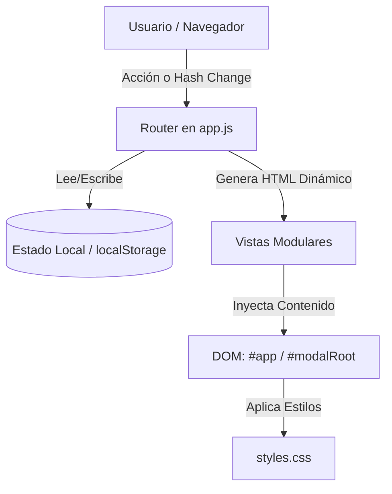

# 🚀 Nacens Tech — Talento que se une

> **Plataforma web para conectar talentos, formar equipos complementarios y crear empresas tecnológicas con impacto real en Jujuy, Argentina.**

[](https://developer.mozilla.org/es/docs/Web/HTML)
[](https://developer.mozilla.org/es/docs/Web/CSS)
[](https://developer.mozilla.org/es/docs/Web/JavaScript)
[](#arquitectura-y-diseño)
[](LICENSE)

---

## 📌 Tabla de Contenidos

- [Propósito del Proyecto](#-propósito-del-proyecto)
- [Características Principales](#-características-principales)
- [Estructura del Proyecto](#-estructura-del-proyecto)
  - [index.html](#indexhtml)
  - [styles.css](#stylescss)
  - [app.js](#appjs)
- [Cómo Ejecutar el Proyecto](#-cómo-ejecutar-el-proyecto)
  - [Opción 1: Apertura directa](#opción-1-apertura-directa-en-el-navegador)
  - [Opción 2: Servidor local ligero (Recomendado)](#opción-2-servidor-local-ligero-recomendado)
- [Arquitectura y Funcionamiento Interno](#-arquitectura-y-funcionamiento-interno)
- [Tecnologías Utilizadas](#-tecnologías-utilizadas)
- [Ecosistema y Audiencia](#-ecosistema-y-audiencia)
- [Autor y Contacto](#-autor-y-contacto)

---

## 💡 Propósito del Proyecto

**Nacens Tech** es una propuesta y plataforma web interactiva diseñada para impulsar la **economía del conocimiento y el emprendimiento tecnológico en Jujuy**.

### El Desafío
En la región existe una creciente masa de talentos en desarrollo de software, diseño UX/UI, inteligencia artificial y gestión de proyectos. Sin embargo, muchas iniciativas no logran consolidarse debido a:
- Dificultad para encontrar perfiles complementarios para formar un equipo multidisciplinario equilibrado.
- Falta de instancias tempranas de validación de ideas con usuarios y problemas reales.
- Desconexión entre las necesidades tecnológicas del sector productivo/institucional y los talentos emergentes.

### La Solución
Nacens Tech propone un recorrido estructurado en 4 etapas:
1. **Registro de Talento:** Creación de perfil con habilidades técnicas, rol e intereses.
2. **Matching Inteligente:** Algoritmo conceptual de compatibilidad para formar equipos complementarios (Desarrollo + Diseño + IA + Negocios).
3. **Validación Temprana:** Participación en retos e instancias de ideación y prototipado.
4. **Creación de Empresas & Oportunidades:** Conexión con proyectos reales de pymes, instituciones y comercios locales para lanzar MVPs sostenibles.

---

## ✨ Características Principales

- **Arquitectura SPA (Single Page Application):** Navegación fluida e instantánea sin recarga de página mediante Hash Routing (`#inicio`, `#equipos`, `#desafios`, `#oportunidades`, etc.).
- **Persistencia en el Cliente:** Utiliza `localStorage` para guardar el estado de sesión del usuario, equipos a los que se une, proyectos guardados, postulaciones a oportunidades y desafíos inscritos.
- **Módulo de Perfil y Autenticación Demo:**
  - Registro e inicio de sesión local para pruebas.
  - Edición de biografía, rol, habilidades y disponibilidad en modal emergente.
  - Cálculo dinámico del porcentaje de completitud del perfil.
- **Explorador de Equipos:** Catálogo de equipos multidisciplinarios con cálculo de porcentaje de compatibilidad, desglose de integrantes con avatares visuales, stack de tecnologías y filtrado reactivo por disciplina (*Desarrollo*, *Diseño*, *IA*).
- **Desafíos y Validación:** Retos prácticos orientados a resolver problemas concretos de la comunidad con mentoría y retroalimentación.
- **Banco de Oportunidades:** Proyectos y requerimientos de organizaciones locales que buscan talento, con posibilidad de guardar en favoritos y registrar postulación interactiva.
- **Sistema de Feedback al Usuario:** Notificaciones emergentes (*Toasts*) temporizadas y modales accesibles para confirmaciones y edición.
- **Diseño 100% Responsivo:** Adaptado con minuciosidad para pantallas de escritorio, tablets y dispositivos móviles con menú hamburguesa colapsable.

---

## 📁 Estructura del Proyecto

El proyecto está construido con un enfoque **Vanilla Web puro** (sin frameworks pesados ni dependencias externas), lo que garantiza máxima velocidad de carga, ligereza y facilidad de mantenimiento:

```text
Nascent/
├── index.html        # Estructura semántica base y contenedores principales
├── styles.css        # Sistema de diseño, variables, componentes y media queries
├── app.js            # Lógica SPA, estado reactivo, enrutamiento y datos demo
└── README.md         # Documentación profesional del proyecto
```

### `index.html`
Es el punto de entrada HTML5 semántico de la aplicación:
- **Metadatos y Accesibilidad:** Declaración `lang="es-AR"`, etiquetas `<meta>` para viewport móvil, color de tema para la barra del navegador (`#071b39`) y descripciones optimizadas.
- **Top Bar & Navegación:** Encabezado con efecto de desenfoque (*backdrop-filter blur*), logotipo en SVG interactivo de Nacens Tech, enlaces de navegación temática y botones de acción rápida (*Ingresar*, *Crear cuenta*, menú hamburguesa).
- **Contenedor Principal (`<main id="app">`):** Espacio donde el script `app.js` inyecta dinámicamente las diferentes vistas según la ruta activa.
- **Elementos de Interfaz Globales:** Contenedor de notificaciones flotantes (`#toast`) y capa para ventanas modales accesibles (`#modalRoot`).
- **Footer Corporativo:** Enlaces rápidos, resumen de la iniciativa y avisos de prototipo demostrativo.

### `styles.css`
Contiene la identidad visual y el sistema de diseño completo de Nacens Tech:
- **Variables CSS (`:root`):** Paleta cromática corporativa (Navy `#071b39`, Text `#0d2142`, Accent Blue `#1161fa`, Emerald Green `#21d98d`, Background `#f6f9ff`), tipografía y radios de borde estandarizados.
- **Tipografía:** Integración de la fuente moderna **Inter** desde Google Fonts con diversos pesos jerárquicos (400 a 900).
- **Componentes Modulares:**
  - Botones estilizados con microinteracciones y gradientes (`.btn-primary`, `.btn-outline`, `.btn-ghost`).
  - Tarjetas interactivas con elevación y sombras suaves (`.card`, `.team-card`).
  - Chips de filtrado interactivo (`.chip.active`) y tags de habilidades (`.tag`).
  - Avatares superpuestos para miembros de equipos con gradientes distintivos (`.avatars`, `.avatar`).
  - Elementos gráficos destacados: orbe tecnológico animado en el Hero mediante SVG y gradientes radiales.
- **Responsive Design:** Media queries optimizadas para tres puntos de quiebre (breakpoints a 1100px, 900px y 620px), transformando la disposición en grillas adaptables y activando el menú móvil.

### `app.js`
Es el cerebro de la aplicación web, programado en JavaScript moderno (ES6+):
- **Base de Datos Simulada en Memoria:** Define conjuntos de datos de prueba (`DEMO_TEAMS`, `DEMO_JOBS`, `DEMO_CHALLENGES`) con información contextual de Jujuy y la región.
- **Gestión de Estado (`state`):** Almacena y sincroniza reactivamente con `localStorage`:
  - `user`: Datos del perfil activo (nombre, email, especialidad, habilidades, biografía).
  - `joined`: Lista de identificadores de equipos a los que el usuario se ha unido.
  - `applied`: Postulaciones a proyectos realizadas.
  - `saved`: Oportunidades marcadas como favoritas.
  - `challenges`: Inscripciones a desafíos.
  - Filtros activos en tiempo real.
- **Enrutador Hash (`render` / `go`):** Escucha el evento `hashchange` de la ventana y traduce rutas como `#inicio`, `#como-funciona`, `#equipos`, `#equipo/:id`, `#oportunidades`, `#proyecto/:id`, `#registro` a la vista correspondiente sin recargar la página.
- **Delegación de Eventos:** Gestión limpia de acciones mediante selectores `[data-action]`, permitiendo navegación, apertura de modales, guardado y logout de forma desacoplada.
- **Seguridad en Renderizado:** Función `escapeHtml` para sanitizar inputs de usuario y prevenir inyecciones XSS.

---

## 🚀 Cómo Ejecutar el Proyecto

Al tratarse de una solución basada en tecnologías web nativas, **no requiere instalación previa de Node.js, npm ni herramientas de compilación**.

### Opción 1: Apertura directa en el navegador
1. Descarga o clona el repositorio en tu computadora.
2. Haz doble clic sobre el archivo `index.html` (o clic derecho > *Abrir con* > *Google Chrome*, *Mozilla Firefox*, *Microsoft Edge*, etc.).
3. ¡Listo! La aplicación funcionará con todas sus características interactivas.

### Opción 2: Servidor local ligero (Recomendado)
Para una experiencia idéntica a un entorno de producción (rutas limpias y simulación HTTP):

#### Usando Python (Preinstalado en la mayoría de sistemas):
```bash
# Navega al directorio del proyecto
cd Nascent

# Inicia un servidor web local en el puerto 8000
python -m http.server 8000
```
Luego, abre en tu navegador: [http://localhost:8000](http://localhost:8000)

#### Usando Node.js (npx serve):
```bash
npx serve .
```

#### Usando la extensión Live Server de VS Code:
1. Abre la carpeta del proyecto en **Visual Studio Code**.
2. Haz clic derecho sobre `index.html` y selecciona **"Open with Live Server"**.

---

## 🔬 Arquitectura y Funcionamiento Interno



### Ciclo de Vida de una Acción:
1. El usuario interactúa con un botón o enlace con atributo `data-action` (por ejemplo, inscribirse a un desafío o guardar una oportunidad).
2. El listener global captura el evento y delega la ejecución a `handleAction()`.
3. Si la acción requiere autenticación, el sistema valida `state.user` y redirige amigablemente al registro si es necesario.
4. Se actualiza el estado interno, se persiste en `localStorage` y se dispara una notificación `toast()` con feedback inmediato.
5. La vista se vuelve a renderizar reflejando el cambio de estado (botones en estado "Guardado", "Unido", etc.).

---

## 🛠️ Tecnologías Utilizadas

- **HTML5:** Marcado semántico, accesibilidad (WAI-ARIA básico), SVG inline.
- **CSS3:** Flexbox, CSS Grid, Custom Properties (variables CSS), transiciones y gradientes modernos, responsive media queries.
- **JavaScript (ES6+):** Programación funcional, manipulación de DOM, LocalStorage API, Hash-based Routing, Template Literals.

---

## 👥 Ecosistema y Audiencia

| Perfil | Rol en Nacens Tech |
| :--- | :--- |
| **Estudiantes y Jóvenes Talentos** | Desarrollar habilidades prácticas, formar sus primeros equipos de trabajo y crear proyectos de base tecnológica. |
| **Profesionales Experimentados** | Aportar experiencia técnica y de negocio a proyectos emergentes en calidad de co-fundadores o mentores. |
| **Empresas e Instituciones** | Plantear problemas y desafíos reales para encontrar soluciones innovadoras y conectar con talento local calificado. |
| **Emprendedores** | Validar hipótesis de negocio, conseguir perfiles técnicos complementarios y estructurar su MVP. |

---

## 📄 Licencia

Este proyecto está bajo la Licencia [MIT](LICENSE) — siéntete libre de utilizarlo, modificarlo y adaptarlo para tus propios desarrollos.

---

<p align="center">
  <b>Nacens Tech</b> · <i>Talento. Equipos. Empresas.</i><br>
  Jujuy, Argentina · Prototipo Demostrativo 2026
</p>
